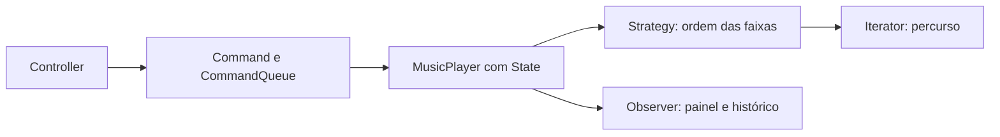
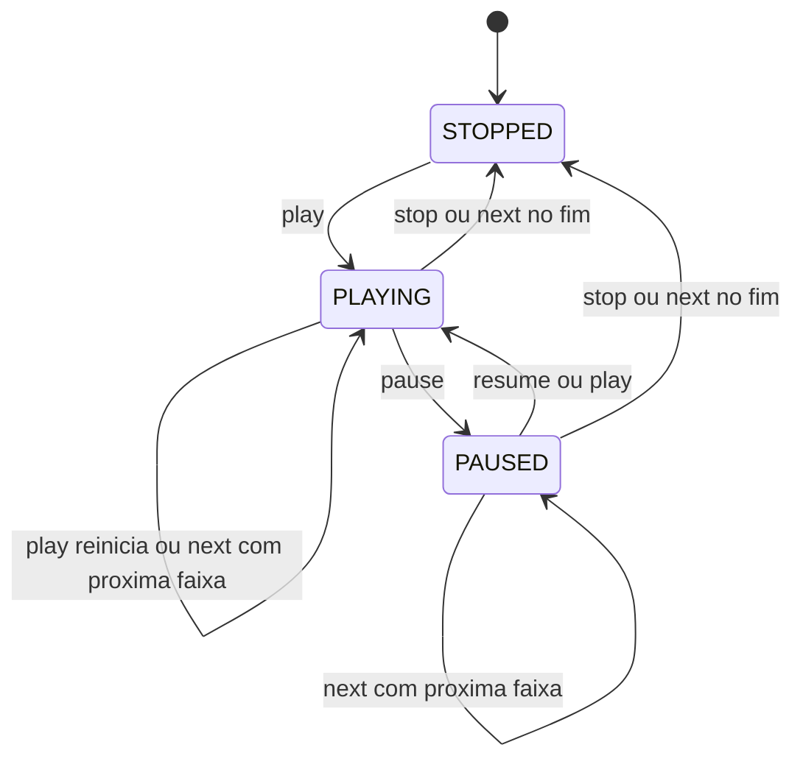

-----

-----

<p align="center">
  
</p>

-----


# Lista 03 — Padrões Comportamentais

Disciplina do curso de Engenharia de Software da Universidade de Pernambuco — Campus Garanhuns

-----

## 📌 Sobre a lista

O AlexaPatterns é uma API que simula um assistente musical. A equipe de
administração cadastra músicas, cada conta monta suas playlists e controla o
próprio tocador com pedidos como "tocar", "pausar" e "próxima". Cada conta
também tem uma fila de pedidos, um painel com a última notificação e um
histórico de tudo o que aconteceu no tocador.

O projeto inicial já contém a aplicação Spring Boot, a persistência, a
autenticação com JWT, as regras de acesso, os controllers e os testes. Nesta
lista, você implementará cinco Padrões de Projeto comportamentais em **15
arquivos** indicados adiante:
- Strategy 
- Iterator
- State 
- Observer 
- Command

Os padrões trabalham juntos: o pedido chega como um **Command**, que o
`MusicPlayer` entrega ao **State** atual; ao iniciar uma playlist, o player
pede a ordem a uma **Strategy** e percorre as faixas com um **Iterator**; a
cada mudança, os **Observers** (painel e histórico) são notificados.



Todas as soluções serão validadas por **testes automatizados executados por
meio do mvn**.

---

## Como entregar

1. Faça um **fork** deste repositório para a sua conta do GitHub.
2. Clone o seu fork:
   ```bash
   git clone URL_DO_SEU_FORK
   cd alexa-patterns
   ```
3. Crie uma branch a partir da `main`:
   ```bash
   git checkout -b entrega-seu-nome
   ```
4. Implemente os exercícios. Você pode fazer quantos commits quiser:
   ```bash
   git add .
   git commit -m "Implementa Strategy"
   ```
5. Suba a sua branch para o seu fork:
   ```bash
   git push -u origin entrega-seu-nome
   ```
6. Abra um Pull Request do seu fork para a `main` deste repositório.
7. O avaliador roda automaticamente e publica a nota no Pull Request.
8. Envie quantas vezes quiser (novos pushes na mesma branch atualizam a
   avaliação), mas antes de fazê-lo garanta que sua solução passa
   localmente, **inclusive no Checkstyle**.

---

## Rodando localmente

```bash
mvn test              # confere o estilo e roda todos os testes
mvn checkstyle:check  # confere somente o estilo de código (linter)
```

Para rodar um único teste:

```bash
mvn test -Dtest=Req03StateTest
```

Requisitos de ambiente: **JDK 17** e **Maven 3.8+**.

> O Checkstyle roda **antes** dos testes. Se houver qualquer violação de estilo,
> o Maven para ali e nenhum teste é executado. Leia a seção
> [Estilo de código](#estilo-de-código-checkstyle) antes de começar.

Para rodar apenas os testes, não é necessário iniciar a API nem definir
variáveis de ambiente: o perfil `test` configura tudo.

---

## Estrutura do projeto

```
src/main/java/br/upe/alexapatterns/
├── advice/ config/ dto/ exception/   compartilhado: erros, Swagger, estratégias (pronto)
├── staff/                            contas, login, JWT e Spring Security (pronto)
├── track/                            catálogo de músicas (pronto)
├── playlist/                         playlists das contas (pronto)
│   └── iterator/                     #2 Iterator
├── playback/
│   ├── strategy/                     #1 Strategy
│   ├── state/                        #3 State  (MusicPlayer é o contexto, pronto)
│   ├── observer/                     #4 Observer
│   └── event/ entity/ dto/           eventos, enums e snapshot (pronto)
└── assistant/                        controllers e sessão por conta (pronto)
    └── command/                      #5 Command
```

Cada método que você precisa implementar já existe com a assinatura correta e
com um `Javadoc` que descreve o comportamento esperado.

### ✏️ Arquivos que você pode alterar

O avaliador copia **somente estes 15 arquivos** da sua entrega sobre a base
oficial do repositório:

```
src/main/java/br/upe/alexapatterns/playback/strategy/SequentialPlaybackStrategy.java
src/main/java/br/upe/alexapatterns/playback/strategy/ShuffledPlaybackStrategy.java
src/main/java/br/upe/alexapatterns/playlist/iterator/PlaylistIterator.java
src/main/java/br/upe/alexapatterns/playback/state/StoppedState.java
src/main/java/br/upe/alexapatterns/playback/state/PlayingState.java
src/main/java/br/upe/alexapatterns/playback/state/PausedState.java
src/main/java/br/upe/alexapatterns/playback/observer/PlaybackEventPublisher.java
src/main/java/br/upe/alexapatterns/playback/observer/PlaybackPanel.java
src/main/java/br/upe/alexapatterns/playback/observer/PlaybackHistory.java
src/main/java/br/upe/alexapatterns/assistant/command/PlayCommand.java
src/main/java/br/upe/alexapatterns/assistant/command/PauseCommand.java
src/main/java/br/upe/alexapatterns/assistant/command/ResumeCommand.java
src/main/java/br/upe/alexapatterns/assistant/command/NextCommand.java
src/main/java/br/upe/alexapatterns/assistant/command/StopCommand.java
src/main/java/br/upe/alexapatterns/assistant/command/CommandQueue.java
```

Atenção a três consequências:

- **Qualquer outra alteração é ignorada** na avaliação oficial: `pom.xml`,
  testes, workflow, controllers, segurança e demais classes.
- **Não crie arquivos novos.** Uma classe nova fora dessa lista não é copiada
  e a compilação oficial falha. Classes internas (`private static class`)
  dentro dos 15 arquivos são permitidas.
- **Não apague nem renomeie** nenhum dos 15 arquivos: se algum estiver ausente,
  a avaliação fica incompleta e não gera nota.

---

## Estilo de código (Checkstyle)

O projeto usa o **Google Java Style** (`google_checks.xml`) e o build falha com
qualquer aviso. Os pontos que mais derrubam entregas:

- **Javadoc nos métodos públicos.** O esqueleto já traz; mantenha-os e
  documente qualquer método público novo. A primeira frase termina com ponto.
- **Indentação de 2 espaços**, e linhas com no máximo **100 colunas**.
- **Imports explícitos**, sem `import java.util.*`.
- **Todos os imports em um único bloco, em ordem alfabética**, sem linhas em
  branco entre eles (os `import static` vêm antes, em um bloco separado).
- Espaço antes de `{`, e `}` sozinho na linha.

### Configurando o IntelliJ

O IntelliJ vem com um padrão diferente (4 espaços e `java.*` no final dos
imports). Ajuste uma vez em `Ctrl+Alt+S` → *Editor* → *Code Style* → *Java*:

1. Aba **Tabs and Indents**: *Tab size* `2`, *Indent* `2`, *Continuation
   indent* `4`.
2. Aba **Imports**, em *Import Layout*, deixe somente estas duas entradas,
   nesta ordem e com uma `<blank line>` entre elas:
   ```
   import static all other imports
   <blank line>
   import all other imports
   ```
   Apague as linhas `import javax.*` e `import java.*`.
3. Na mesma aba, coloque `999` em *Class count to use import with '\*'* e em
   *Names count to use static import with '\*'*.

> **Cuidado:** reformate apenas os arquivos que você editou. Reformatar o
> projeto inteiro altera arquivos que você não pode modificar.

## Exercícios

### 1. Strategy — ordenar as faixas

Implemente `SequentialPlaybackStrategy` e `ShuffledPlaybackStrategy` em
`playback/strategy`. Ambas implementam `PlaybackOrderStrategy`, cujo único
método é `order(List<Track>)`. O `MusicPlayer` só conhece a interface: o modo
escolhido na API decide qual estratégia será aplicada na próxima reprodução.

| Classe | Comportamento de `order` |
| --- | --- |
| `SequentialPlaybackStrategy` | Devolve as faixas na ordem original. |
| `ShuffledPlaybackStrategy` | Devolve as mesmas faixas em outra ordem, sorteada com o `Random` recebido no construtor. |

Regras que as duas devem cumprir:

1. Devolver uma sequência **nova e independente**: limpar ou alterar a lista de
   entrada depois da chamada não pode afetar o resultado, e a entrada nunca é
   modificada.
2. **Preservar todas as ocorrências**: se uma faixa aparece duas vezes na
   entrada, aparece duas vezes na saída.
3. Aceitar listas vazias e com um único elemento.
4. No embaralhamento, usar de fato o `Random` fornecido. Duas estratégias
   criadas com a mesma semente produzem a mesma ordem para a mesma entrada.

Para observar pela API, depois de criar uma playlist com várias músicas:

```http
PUT /api/assistant/mode
Authorization: Bearer <token>
Content-Type: application/json

{"mode": "SHUFFLED"}
```

A resposta (`200 OK`) é o estado atual, por exemplo
`{"status": "STOPPED", "currentTrack": null}`. Em seguida,
`POST /api/assistant/commands` com `{"action": "PLAY", "playlistId": 1}` toca
a primeira faixa **da ordem sorteada**. No modo `SEQUENTIAL`, a primeira faixa
é sempre a primeira da playlist. Trocar o modo não reordena uma reprodução em
andamento. Rode `mvn -Dtest=Req01StrategyTest test`.

### 2. Iterator — percorrer a sequência

Implemente `PlaylistIterator` em `playlist/iterator`: o construtor, `hasNext()`
e `next()`. A classe `PlaylistSequence` já existe e entrega um **novo**
iterador a cada chamada de `iterator()`; o `MusicPlayer` usa esse iterador para
avançar de faixa.

Regras que a implementação deve cumprir:

1. O construtor captura **uma cópia** da lista recebida: alterar a lista
   original depois não muda o percurso.
2. Percorre as faixas na ordem, preservando as repetições.
3. `hasNext()` apenas consulta: chamá-lo várias vezes seguidas não consome
   nenhuma faixa.
4. Depois da última faixa, `next()` lança `NoSuchElementException` (em todas as
   chamadas seguintes também) e `hasNext()` continua devolvendo `false`.
5. Uma lista vazia já nasce esgotada.
6. `remove()` não é permitido: lança `UnsupportedOperationException` e não
   altera o percurso.
7. Iteradores criados pela mesma `PlaylistSequence` são independentes: cada um
   tem a sua própria posição.

Pela API, com a playlist `A, B, A` no modo `SEQUENTIAL`: `PLAY` toca `A`, o
primeiro `NEXT` toca `B`, o segundo toca `A` de novo e o terceiro encerra o
tocador (`STOPPED`). Rode `mvn -Dtest=Req02IteratorTest test`.

### 3. State — comportamento por estado

Implemente `StoppedState`, `PlayingState` e `PausedState` em `playback/state`.
A interface `PlaybackState` já rejeita por padrão `pause`, `resume` e `next`
com `ConflictException`; cada estado só precisa implementar o que é válido
nele. O `MusicPlayer` é o contexto e já oferece as operações que os estados
usam (pacote `playback.state`):

| Operação do `MusicPlayer` | O que faz |
| --- | --- |
| `beginPlaylist(tracks)` | Aplica a estratégia, cria o iterador e seleciona a primeira faixa. Rejeita lista vazia com `BadRequestException` **antes** de alterar qualquer coisa. |
| `advance()` | Passa para a próxima faixa. Devolve `false` quando a sequência acabou. |
| `clearPlaylist()` | Descarta o percurso e a faixa atual. |
| `changeState(estado)` | Troca o estado atual. |

Os estados **não publicam eventos**: o `MusicPlayer` publica uma notificação
sozinho sempre que uma ação realmente altera algo.



| Estado | `play` | `pause` | `resume` | `next` | `stop` |
| --- | --- | --- | --- | --- | --- |
| `STOPPED` | Inicia a playlist e vai para `PLAYING`. | Conflito. | Conflito. | Conflito. | Não faz nada. |
| `PLAYING` | Reinicia pela primeira faixa e continua `PLAYING`. | Vai para `PAUSED`. | Conflito. | Próxima faixa; se acabou, vai para `STOPPED`. | Encerra e vai para `STOPPED`. |
| `PAUSED` | Substitui a playlist e vai para `PLAYING`. | Conflito. | Vai para `PLAYING`. | Próxima faixa **sem sair de `PAUSED`**; se acabou, vai para `STOPPED`. | Encerra e vai para `STOPPED`. |

"Conflito" significa lançar `ConflictException` (na API, `409 Conflict`).

Regras que a implementação deve cumprir:

1. Uma ação inválida no estado atual lança `ConflictException`, **sem alterar o
   estado, a faixa ou o histórico** e sem publicar evento.
2. `stop` com o tocador já parado não faz nada e **não gera evento**.
3. `play` com playlist vazia lança `BadRequestException` (`400`) em qualquer
   estado, preservando estado, faixa atual e posição, e sem evento.
4. Quando o `next` chega ao fim da playlist, o tocador vai para `STOPPED` e a
   faixa atual é removida; um novo `next` passa a ser conflito.
5. Depois de um `stop`, não é possível `resume` nem `next`; um novo `play`
   recomeça do início.
6. `pause` seguido de `resume` preserva a faixa e a posição.

Pela API, com o tocador parado:

```http
POST /api/assistant/commands
Authorization: Bearer <token>
Content-Type: application/json

{"action": "PAUSE"}
```

Resposta (`409 Conflict`): `{"error": "Ação PAUSE não permitida no estado STOPPED"}`.
Rode `mvn -Dtest=Req03StateTest test`.

### 4. Observer — notificar painel e histórico

Implemente `PlaybackEventPublisher`, `PlaybackPanel` e `PlaybackHistory` em
`playback/observer`. As interfaces `PlaybackObserver` (método `update(event)`)
e `PlaybackPublisher` (`subscribe`, `unsubscribe` e `publish`) e o registro
`PlaybackEvent` (`action`, `status`, `currentTrack`, `occurredAt`) já existem.

| Classe | Responsabilidade |
| --- | --- |
| `PlaybackEventPublisher` | Gerencia as inscrições e notifica os assinantes a cada `publish`. |
| `PlaybackPanel` | Guarda **somente o último** evento recebido; `getLatest()` devolve `Optional.empty()` antes do primeiro. |
| `PlaybackHistory` | Registra **todos** os eventos, em ordem e com repetições; `getEvents()` devolve uma cópia não modificável e independente. |

Regras do publicador:

1. Publicar sem nenhum assinante não lança erro.
2. Os assinantes são notificados **na ordem de inscrição**, todos com o mesmo
   evento.
3. Inscrever o mesmo observador duas vezes não duplica as notificações.
4. Depois de `unsubscribe`, o observador não recebe mais eventos. Remover um
   observador que não está inscrito não faz nada.
5. Quem se inscreve depois não recebe eventos anteriores.
6. Inscrições e remoções feitas **durante** uma publicação só valem a partir do
   próximo evento.
7. Publicadores, painéis e históricos **não compartilham estado** entre si.

Pela API, cada ação bem-sucedida gera um evento:

```http
GET /api/assistant/panel
Authorization: Bearer <token>
```

```json
{
  "action": "PLAY",
  "status": "PLAYING",
  "currentTrack": {"id": 1, "title": "Aquarela", "artist": "Toquinho", "durationSeconds": 260},
  "occurredAt": "2030-04-02T12:00:00.000Z"
}
```

Antes do primeiro evento o painel responde `204 No Content`. Com
`DELETE /api/assistant/panel/subscription`, o painel **para de ser atualizado**
mas mantém a última notificação, enquanto o histórico continua registrando.
`PUT /api/assistant/panel/subscription` o inscreve de novo (repetir a chamada
não duplica nada) e ele volta a receber apenas os eventos **seguintes**. Rode
`mvn -Dtest=Req04ObserverTest test`.

### 5. Command — pedidos como objetos

Implemente `PlayCommand`, `PauseCommand`, `ResumeCommand`, `NextCommand`,
`StopCommand` e `CommandQueue` em `assistant/command`. A interface
`PlaybackCommand` tem um único método, `execute()`. O serviço da API já cria os
comandos e usa a fila; os construtores dos comandos já guardam o tocador.

Regras dos comandos:

1. **Criar** um comando não executa nada no tocador.
2. `execute()` delega **uma única vez** ao método correspondente do
   `MusicPlayer` e não faz mais nada com ele.
3. `PlayCommand` guarda uma **cópia** da lista de faixas: alterar a lista
   original depois de criar o comando não muda o que será tocado.
4. Se o tocador lançar uma exceção, o comando a propaga **sem capturar, embrulhar
   nem repetir** a execução.

Regras da fila (`CommandQueue`):

1. `enqueue` registra o comando **sem executá-lo** e rejeita `null` com
   `NullPointerException`, sem alterar os pedidos já enfileirados. A mesma
   instância pode ser enfileirada mais de uma vez.
2. Os comandos são executados na **ordem de inclusão**.
3. `executeNext()` remove e executa um único comando e devolve `true`; com a
   fila vazia, devolve `false`.
4. `executeAll()` executa tudo em ordem e devolve quantos comandos concluiu.
   Se um comando falhar, a execução **para** e a exceção é propagada: o comando
   que falhou já saiu da fila e os seguintes continuam pendentes.
5. `size()` informa quantos comandos estão pendentes e `clear()` os descarta
   sem executar. A fila pode ser reutilizada depois.
6. Filas diferentes **não compartilham** comandos.

Pela API:

```http
POST /api/assistant/queue
Authorization: Bearer <token>
Content-Type: application/json

{"action": "PLAY", "playlistId": 1}
```

Resposta (`201 Created`): `{"pendingCommands": 1}`. Nada foi tocado ainda.
Depois de enfileirar também `PAUSE` e `RESUME`, `POST /api/assistant/queue/execute`
responde (`200 OK`):

```json
{
  "executedCommands": 3,
  "pendingCommands": 0,
  "playback": {
    "status": "PLAYING",
    "currentTrack": {"id": 1, "title": "Aquarela", "artist": "Toquinho", "durationSeconds": 260}
  }
}
```

Se a fila for `PLAY`, `PAUSE`, `PAUSE`, `RESUME`, `NEXT`, a execução responde
`409 Conflict` no segundo `PAUSE` (o tocador já está pausado). Esse comando é
descartado, o tocador permanece `PAUSED` e a fila fica com `2` pendentes
(`RESUME` e `NEXT`). Rode `mvn -Dtest=Req05CommandTest test`.

---

## Testes e avaliação

Execute os comandos na raiz do projeto:

```bash
mvn -Dtest=Req01StrategyTest test
mvn -Dtest=Req02IteratorTest test
mvn -Dtest=Req03StateTest test
mvn -Dtest=Req04ObserverTest test
mvn -Dtest=Req05CommandTest test
mvn -Dtest=ApiSecurityTest test
mvn -Dtest=HttpFlowTest test
mvn test
mvn checkstyle:check
```

`Req01`–`Req05` verificam cada padrão **sem depender dos outros**.
`ApiSecurityTest` verifica login, papéis e isolamento das playlists e não
depende dos padrões. `HttpFlowTest` exercita os cinco padrões juntos pela API e
só passa depois de todos os requisitos. Por isso, no projeto inicial os testes
`Req01`–`Req05` e `HttpFlowTest` **falham**, e `mvn test` passa quando o
trabalho está concluído.

| Critério | Testes | Pontos |
| --- | ---: | ---: |
| Strategy | 6 | 15 |
| Iterator | 7 | 10 |
| State | 12 | 25 |
| Observer | 14 | 20 |
| Command | 16 | 25 |
| Estilo de código (Checkstyle) | — | 5 |
| **Total** | | **100** |

A nota mínima é **80 pontos**. Além dela, **Segurança da API** (8 testes) e
**Fluxo HTTP completo** (4 testes) são obrigatórios: os dois precisam passar
integralmente para que o resultado seja aprovado.

> ⚠️ **O Checkstyle vem primeiro.** O avaliador roda a verificação de estilo
> antes de compilar e testar. Com **uma única violação**, os testes não são
> executados e todos os requisitos aparecem como "bloqueado pelo Checkstyle".
> Rode `mvn checkstyle:check` antes de cada push.

O comentário no Pull Request informa a pontuação por requisito. Antes de
enviar, confira:

1. `mvn test` passa, com o Checkstyle sem violações.
2. Somente os 15 arquivos listados foram alterados.
3. Arquivos locais como `target/` e `.idea/` não entraram no commit.
